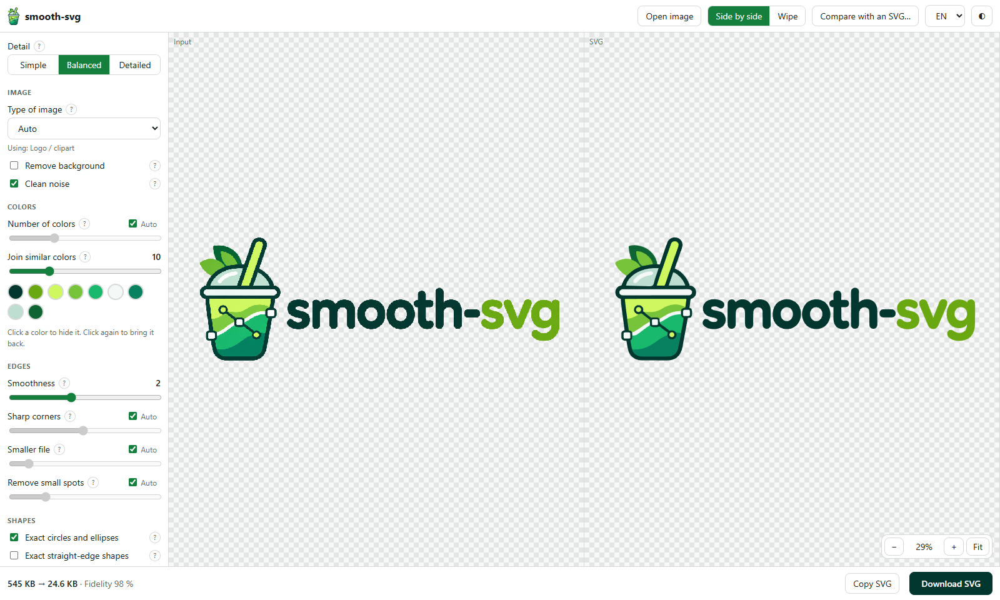
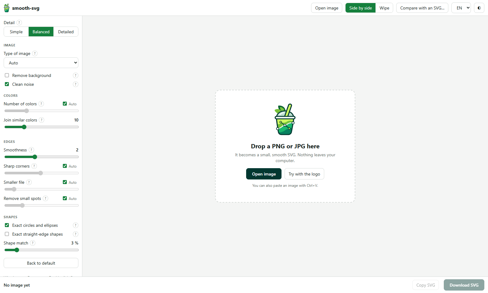
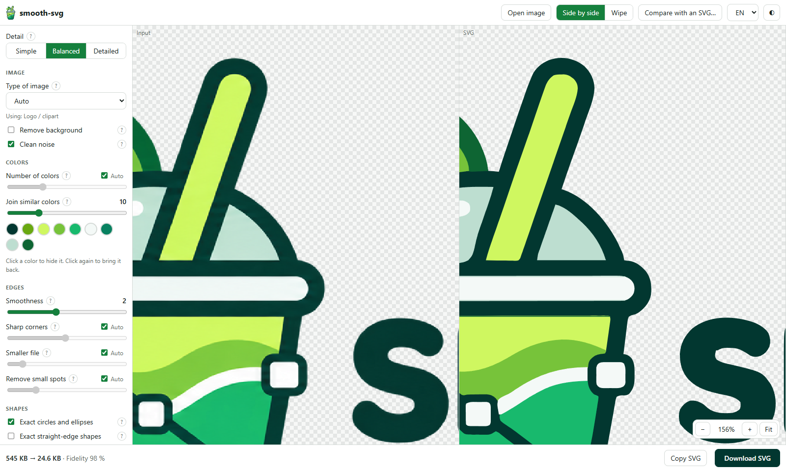
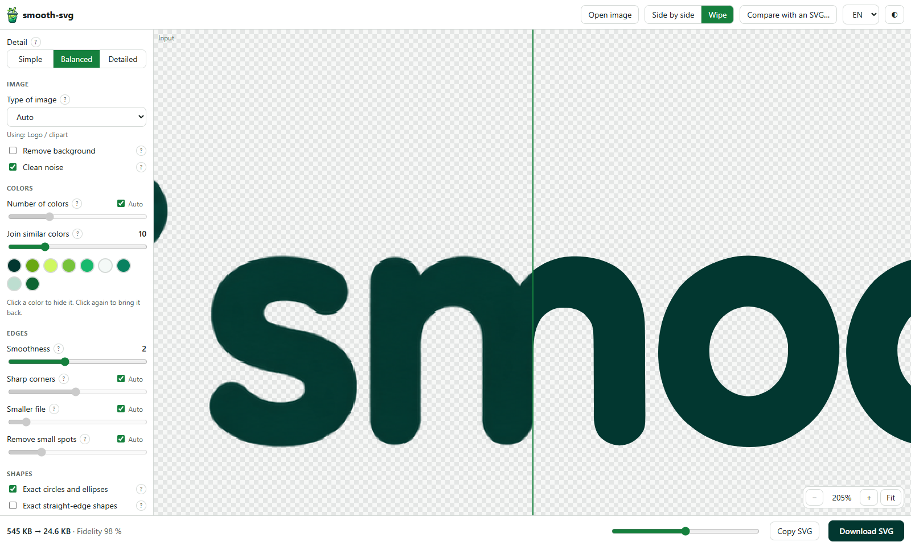

<p align="center">
  
</p>

<p align="center">
  <b>Turn a PNG or JPG into a small, smooth SVG.</b><br>
  Few colors. Few paths. Round curves instead of pixel stairs. Exact circles where the picture has circles.
</p>

<p align="center">
  
  
  
</p>



smooth-svg is a command line tool and a local web page. It cuts a raster image to a small palette,
smooths the edges, and writes an SVG that looks like something drawn by hand: a few flat colors,
clean outlines, and real circles and ellipses. Nothing is uploaded; it runs on your computer.

The logo above is its own output. `branding/Logo+name.png` is 558 KB. `branding/Logo+name.svg`, made
by this tool, is 25 KB.

## Example

The project logo (2172 x 724 px), converted two ways:

| | Paths | Colors | Size | SSIM |
|---|---|---|---|---|
| Original PNG | n/a | n/a | 558 KB | 1.000 |
| vtracer, default settings | 2144 | 305 | 610 KB | 0.897 |
| smooth-svg | 36 | 9 | 25 KB | 0.985 |

SSIM is the structural similarity between the input and the SVG rendered at the same size
(1.0 means identical). Higher is closer to the original. Reproduce the smooth-svg row with:

```powershell
.\.venv\Scripts\python.exe -m smoothsvg "branding\Logo+name.png" -o logo.svg --compare
```

[vtracer](https://github.com/visioncortex/vtracer) is the tracer used inside smooth-svg. The
"default settings" row is vtracer called directly on the same PNG.

## Install

Built and tested on Windows with Python 3.12. Every dependency installs as a ready-made wheel, so no
compiler is needed.

```powershell
git clone https://github.com/PatrikGuerra/smooth-svg.git
cd smooth-svg
python -m venv .venv
.\.venv\Scripts\python.exe -m pip install -e ".[dev]"
```

## Use the web page

```powershell
.\.venv\Scripts\python.exe -m smoothsvg --ui
```

Your browser opens at <http://127.0.0.1:8765>. The server listens on this computer only. Drop a
PNG/JPG on the page, open one, paste one with `Ctrl+V`, or click **Try with the logo** (up to 20 MB).
The page is in English and Brazilian Portuguese; it follows your browser, and the **EN / PT** switch
in the top bar changes it. Light and dark themes follow your system, and the half-moon button
switches them.



The input is on the left, drawn with square pixels. The SVG is on the right and stays sharp at any
zoom. Both sides move together.



*Zoomed in on the lid of the cup. Left: the PNG. Right: the SVG.*

**Wipe** puts the SVG over the input, with a slider to sweep between them.



Start with **Detail**. It sets several controls at once: **Simple** gives fewer colors and rounder
edges, **Balanced** uses what the image type suggests, **Detailed** keeps more of the picture. Every
control has a **?** that explains it. Controls with an **Auto** box let the tool decide until you
untick it.

| Control | What it does |
|---|---|
| Detail | Simple, Balanced or Detailed. Moves the controls below together |
| Type of image | Auto (default), Logo / clipart, Line drawing, Pixel art, Photo |
| Remove background | Makes the color around the edge transparent |
| Clean noise | Smooths JPG noise before the colors are picked. Turn it off for crisp pixel art |
| Number of colors | How many flat colors the SVG uses. Auto picks the smallest number that still looks right |
| Join similar colors | Colors closer than this become one. Higher means fewer colors |
| Color dots | Click a dot to hide that color, click again to bring it back |
| Smoothness (0 to 5) | Rounder edges and fewer tiny details when higher |
| Sharp corners | Bends sharper than this angle stay pointed. Auto follows Smoothness |
| Smaller file | Fewer curve points: a smaller file, a little less exact |
| Remove small spots | Spots smaller than this many pixels (1 to 1024) melt into the color around them |
| Exact circles and ellipses | Round blobs become `<circle>` and `<ellipse>`. On by default |
| Exact straight-edge shapes | Blobs with 3 to 8 straight sides become `<polygon>`. Off by default |
| Shape match (1 to 15 %) | How far a blob may differ from a perfect shape and still be replaced |
| Back to default | Resets every control |
| Compare with an SVG… | Loads an SVG from another tool. The button next to it switches the right side between the two |
| −, +, Fit | Zoom buttons, with the zoom level shown. The mouse wheel, drag and double click work too |
| Download SVG, Copy SVG | Saves or copies the result. `Ctrl+S` downloads too |

The bottom bar shows the input size, the SVG size and the fidelity (SSIM as a percentage). Hover it
for paths, colors, exact shapes and time. The Line drawing type traces one ink shape, so the page
greys out the controls it does not use and says why.

## Use the command line

```powershell
.\.venv\Scripts\python.exe -m smoothsvg input.png -o output.svg
.\.venv\Scripts\python.exe -m smoothsvg input.jpg --model clipart --colors 6 --smooth 3
.\.venv\Scripts\python.exe -m smoothsvg folder\ -o out\          # every PNG/JPG in a folder
.\.venv\Scripts\python.exe -m smoothsvg logo.png --remove-bg --compare
```

| Option | Meaning |
|---|---|
| `-o` | Output SVG, or an output folder |
| `--model` | `auto`, `clipart`, `drawing`, `pixelart`, `photo` |
| `--colors N` | Number of colors (default: auto) |
| `--smooth 0..5` | Edge smoothing (default: by model) |
| `--min-area N` | Merge color islands smaller than N pixels |
| `--remove-bg` | Transparent background |
| `--compare` | Also writes `<name>.compare.png`: input, SVG, difference |

## Models

`auto` looks at the pixels and picks one. You can force any of them.

| Model | Picked when | Tracer | Defaults |
|---|---|---|---|
| `drawing` | Gray image, 90 % of pixels very dark or very light | Potrace, one ink shape | 2 colors, smooth 3 |
| `pixelart` | At most 128 px on a side and at most 32 exact colors | vtracer | smooth 3, keeps every pixel |
| `photo` | More than 25 color bins hold the first 80 % of pixels | vtracer | 8 colors, smooth 1 |
| `clipart` | Everything else | vtracer | auto colors, smooth 2 |

The table is in `smoothsvg/presets.py` and the rules are in `smoothsvg/classify.py`.

## How it works

1. **Cut to a few colors.** k-means in Lab color finds the palette. The count is the smallest one
   where one more color barely helps. Colors closer than the merge threshold become one. The random
   start is seeded, so the same image always gives the same SVG.
2. **Smooth the edges.** Each color becomes a 0/1 mask. The mask is upscaled and blurred, which turns
   stair edges into soft ramps. Each pixel takes the color with the highest value, so the edge is the
   50 % line of the ramp: a smooth curve, and no color outside the palette can appear.
3. **Stack the shapes.** Every connected piece of color is its own shape. Pieces are sorted by area
   with holes filled, biggest first, and each is drawn with its holes filled because what sits in
   them is drawn later, on top. A disc with a chart inside it is just a disc.
4. **Overlap without gaps or lines.** Each shape reaches 2 px under the pieces drawn after it, so no
   gap shows between touching colors. Near its own border that overlap is pulled back, otherwise two
   separately fitted outlines leave a thin line of the lower color along the edge.
5. **Find exact shapes.** A piece that overlaps a circle, ellipse or polygon by at least 100 minus the
   tolerance (in percent) is written as that SVG shape.
6. **Trace and shrink.** vtracer's binary mode traces each remaining piece into spline curves, and
   scour writes the SVG with relative coordinates and short numbers.

## Benchmark

`python -m smoothsvg bench` converts every image in `tests\samples\` and prints SSIM, paths, colors,
size and time, next to the same image traced by vtracer with default settings (`tests\baseline.json`).
If `tests\samples\ref\<name>.svg` exists (for example an SVG from another tool), it also scores that
file against the same input.

The samples are generated by `tests\make_samples.py`, so anyone can rebuild them:

| Sample | Model | Paths | Size (KB) | SSIM |
|---|---|---|---|---|
| Project logo (2172 x 724) | clipart | 2144 → 36 | 610 → 25 | 0.897 → 0.985 |
| Simple logo (shapes) | clipart | 5 → 5 | 7.9 → 7.7 | 0.981 → 0.993 |
| Line drawing | drawing | 4 → 1 | 7.3 → 6.1 | 0.975 → 0.975 |
| Low-res JPG (quality 40) | clipart | 78 → 20 | 50.1 → 10.4 | 0.860 → 0.869 |
| Pixel art heart (13 x 10) | pixelart | 3 → 6 | 0.8 → 0.9 | 0.756 → 0.879 |
| Photo (synthetic gradient) | photo | 1 → 50 | 0.3 → 40.8 | 0.738 → 0.774 |

Each cell is vtracer defaults → smooth-svg. Where the SVG gets larger (pixel art, photo), it is
because the default trace threw away most of the image, which the lower SSIM shows.

Timing on the author's Windows PC: about 3 s for the 1.5 megapixel project logo, about 1 s for a
1 megapixel clipart when only a control changes.

## Limitations

- It is built for logos, icons, drawings and pixel art. Smooth gradients and photos become color
  bands, and the photo model is only a best effort.
- Very small details can vanish at high Smooth levels or below Min area.
- Images over 16 megapixels are refused. Upscaling stops at about 2.5 megapixels of work.
- A circle that another shape partly covers is not recognized as a circle, because its visible
  outline is not one. A ring joined to a handle is not recognized either.
- Removing the background on an image with no clear border color removes the wrong color.
- Polygon detection can flatten curvy pixel art, which is why it is off by default.
- The project has no automated test suite yet. Quality is checked with `bench` and by eye, and the
  web page was checked through its API and with browser screenshots.

## Development

```
smoothsvg/
  __main__.py     command line, bench, --ui
  pipeline.py     the steps, convert_array and convert_image
  presets.py      the model table
  classify.py     picks the model
  quantize.py     k-means palette
  smooth.py       denoise, mask upscale, islands, scour
  drawing.py      Potrace for drawings, the stacked tracer, shape detection
  score.py        render, SSIM, paths and colors, compare image
  server.py       FastAPI app for the web page
  static/         index.html, app.js, i18n.js (EN and PT-BR) and logo.svg, no build step
branding/         the project logos (PNG) and their SVGs, made by this tool
docs/screenshots/ the pictures used in this README
tests/            samples, baseline, and small helper scripts for tuning
```

The page only accepts PNG and JPG (checked by content, not by file name), up to 20 MB and 16
megapixels, and only listens on `127.0.0.1`.

`tests\screenshots.py` retakes the README pictures with Edge or Chrome
(`pip install -e ".[docs]"`). The other scripts in `tests\` are small tuning helpers, not tests.

## License

smooth-svg is free software under the **GNU General Public License v3.0 or later**
(`GPL-3.0-or-later`). The full text is in `LICENSE`.

The `drawing` model imports [`potracer`](https://pypi.org/project/potracer/), a Python port of
Potrace, which is GPL-2.0-or-later. Two other dependencies, `opencv-python-headless` and `scour`, are
Apache-2.0, which is not compatible with GPL-2.0-only but is compatible with GPL-3.0. GPL-3.0-or-later
is the license that fits all three, so any program that includes this code must be released under the
same terms.

Other dependencies keep their own licenses: `vtracer`, `resvg-py`, `scikit-image`, `Pillow`, `numpy`,
`fastapi`, `uvicorn` and (for the screenshots only) `playwright`.
